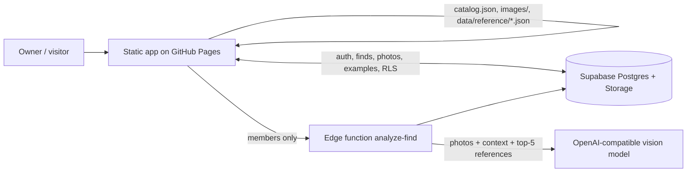

# Rolling Oak Catalog: documentation

Rolling Oak Catalog is a static web app (GitHub Pages) for cataloguing personal finds: artifacts, fossils, rocks and minerals.
Supabase provides sign-in, sharing, cloud sync and the optional AI photo analysis. The app gives **research possibilities, not identifications**. It makes no authenticity or value claims, and it never shows exact find locations publicly.

| Doc | What it covers |
|---|---|
| [architecture.md](architecture.md) | Components, scripts, service worker, edge functions |
| [data-model.md](data-model.md) | Every table and view, plus migrations 001-009 |
| [reference-layer.md](reference-layer.md) | Published typology data: sources, licenses, fields, retrieval |
| [confidence-scoring.md](confidence-scoring.md) | The earned 0-100% score: formula, caps, factors, bands |
| [ai-prompt.md](ai-prompt.md) | The AI system prompt template, the user-message assembly, and an example |
| [rules-engine.md](rules-engine.md) | Offline ranking (analysis.js) and how the references merge into it |
| [user-flows.md](user-flows.md) | Add, review, verify, Discover, AI analysis |
| [privacy.md](privacy.md) | Location handling, visibility, RLS, and the GitHub image caveat |
| [run-deploy-extend.md](run-deploy-extend.md) | Running locally, deploying, secret names, extending |
| [testing.md](testing.md) | Unit tests, Playwright regressions, the shared-module check |
| [limitations-roadmap.md](limitations-roadmap.md) | Known limits and next steps |

Older topic notes are kept: [ai-analysis.md](ai-analysis.md), [auth-setup.md](auth-setup.md), [learning.md](learning.md), [membership.md](membership.md).

