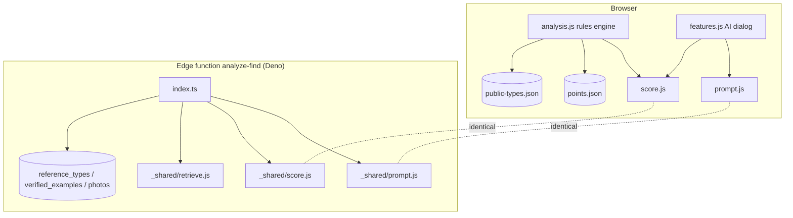

# Architecture

## Front end (no build step)
`index.html` loads plain scripts from `assets/js/`, in this order. Each script attaches one global.

| Script | Global | Role |
|---|---|---|
| config.js | `ROLLING_OAK_CONFIG` | Supabase URL and anon key (public by design), feature flags (`schema008`) |
| brand.js, nav.js | n/a | Branding and navigation |
| cloud.js | `Cloud` | Supabase client wrapper: auth, finds/photos sync, examples, Discover, `analyze()`; `window.ROLLING_OAK_MOCK` swaps in a mock for tests |
| app.js | `App` | Catalog grid, record modal and tabs, review form, IndexedDB `elgin-catalog` |
| retrieve.js | `Retrieve` | Ranks verified examples by similarity (shared with the edge function) |
| **score.js** | `Score` | Earned confidence 0-100 (shared) |
| **prompt.js** | `Prompt` | AI system prompt, external-reference retrieval, user-message assembly (shared) |
| analysis.js | `Analysis` | Rules engine: ranks types from `data/reference/points.json` plus the published layer; renders source chips, the % bar and "Why this score" |
| learning.js | `Learn` | Verified examples and feedback (IndexedDB `rolling-oak-learning`), disclaimer |
| region.js | `Region` | Home region, out-of-area hints |
| corrections.js | `Correct` | Keep / correct history per field |
| marks.js | `Marks` | Photo annotations |
| features.js | n/a | Profiles, collections, sharing, AI dialog including the **View AI prompt** disclosure |
| stage2.js, s5.js | n/a | Discover, comments, status bar, Discover toggles, measurement sources |

The service worker (`sw.js`) caches the shell. Its `VERSION` must go up whenever a cached file changes. On main it is `ro-v8.2`, on this branch `ro-v8.3`, and on Stage 3 `ro-v9`.

## Shared pure modules
`retrieve.js`, `score.js` and `prompt.js` exist twice: once in `assets/js/` and once in `supabase/functions/_shared/`. Each is a UMD-style IIFE with no imports, so it runs in both the browser and Deno. `tools/check_shared.py` fails if the two copies of any file differ.

## Edge functions
- `analyze-find`: members only. It checks the session and `profiles.membership`, gathers verified examples (RLS), retrieves the top 5 published references, calls the model, and clamps the output with `Score.clampCandidates`. **Not deployed from this branch.**
- `stripe-webhook`: sets membership from Stripe events.

## Data files
- `data/catalog.json`: the owner's catalogue (git copy; Supabase `finds` is the cloud copy).
- `data/reference/points.json`: hand-curated type knowledge base (Texas-first). It **wins** whenever it overlaps the published layer.
- `data/reference/public-types.json`: the published reference layer. Generated by `tools/reference/build_reference.py`; see [reference-layer.md](reference-layer.md).
