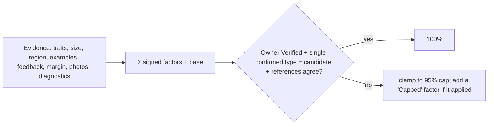

# Earned confidence score (0-100%)

This replaces the old fixed "capped at Moderate" label. Every ranked possibility gets a percentage that is **earned from evidence**, and every point added or removed is listed under **Why this score**. Where a factor comes from a published source, it links to that source. The code is `assets/js/score.js`, which is identical to `supabase/functions/_shared/score.js`.

## Formula
`pct = clamp(1, cap, base + Σ factors)`. The cap is **95%** for both the rules engine and the AI. **100%** is reached only when the owner has **Verified** the find, the owner's single confirmed type is this candidate, and the candidate agrees with the published references (a source chip other than points.json, or a points.json comparison).

| Factor | Points (DEFAULTS) |
|---|---|
| Starting point | +30 |
| Reference traits matching the record | +6 each, max +24 |
| Size inside the published range / measured, not estimated | +8 / +5 more |
| Size outside the range / not recorded / estimate only | −12 / −4 / −5 |
| Type reported from the find's region (bonus, never a filter) | +6 |
| Agrees with verified examples / differs from them | +5 each (max +15) / −5 each |
| 👍 Matches well or Keep responses | +3 each, max +10 |
| Past Wrong / Close / Correct feedback on this type | −6 / −2 / −4 each, floor −20 |
| Lead over the runner-up: ≥3 / ≥1.5 / <1 | +8 / +4 / −10 |
| Conflicting trait | −8 each |
| Photos: <2 / ≥4 / ≥6 | −10 / +4 / +6 |
| Diagnostic features present | +2 each, max +8 |

**AI mode:** the model's own `confidence_pct` is the starting value, and local factors count at half weight. The server clamps the AI value to 95 before it reaches the browser.

## Bands and colours (configurable)
- Bands: High ≥80, Moderate ≥50, Low-moderate ≥30, Low below that. `confidence` still stores the band, so old filters keep working.
- Old text labels map to High 85, Moderate 65, Low-moderate 40, Low 20 (`Score.fromLabel`).
- Bar colour: green ≥70, yellow ≥40, red below that.
- Every threshold lives in `Score.DEFAULTS`. A page can override any of them with `window.ROLLING_OAK_SCORE = {rulesCap: 90, ...}`.

## Server clamp (`Score.clampCandidates`)
- Keeps at most 3 candidates.
- Accepts a number or an old label, and turns garbage into 20.
- Caps at 95 (`aiCap`).
- Keeps up to 8 factors of 160 characters each, with coordinate-like strings replaced by "[coordinates removed]".
- Keeps up to 5 `reference_ids`.

## Examples (screenshots in the package)
- **High:** ELG-001 marked Verified as "Nolan" scores 100% for Nolan, while Travis and Bulverde stay at 70% and 65%. The same find with the ambiguous pick "Nolan/Travis" stays at ≤95%.
- **Low:** ELG-005 (large biface, estimate-only size, close runner-up) scores 46% for the top pick and 22% and 16% for the rest.

## Disclaimer wording
`Learn.DISCLAIMER`: "Research suggestions only, not identifications. No authenticity or value claims. Confidence is an evidence-based score: the rules engine and AI alone stop at 95%; only an owner-Verified find that agrees with published references reaches 100%."
