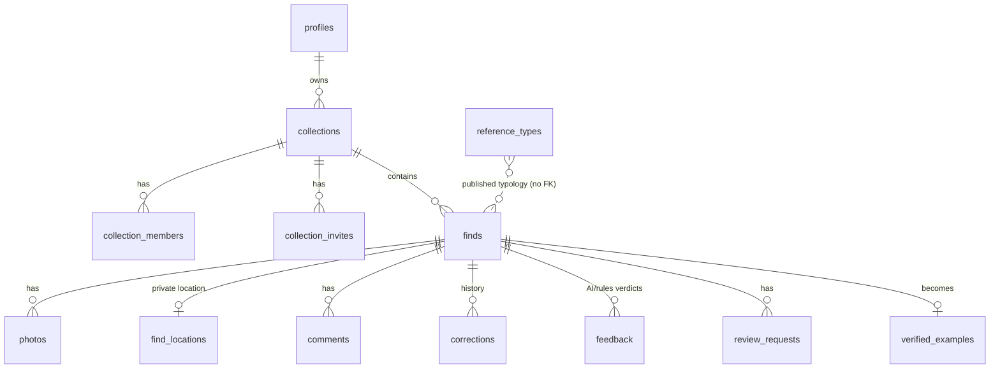

# Data model

The base schema is `supabase/schema.sql`. Migrations in `supabase/migrations/` are **additive** (`add column if not exists`, `create or replace`). Migrations 001-008 are applied to the live project. **009 is written but not applied** (see the bottom of this page).

## Tables (live columns)
| Table | Columns | Notes |
|---|---|---|
| finds | catalog_id, owner, is_public, category, object_type, material, color, length_mm, width_mm, thickness_mm, weight_g, measure_method, condition, key_features, suggestion_1..3, confidence, owner_observations, open_questions, date_found, context_notes, location_sharing, status, era, geologic_period, formation, preservation, hardness, luster, streak, category_note, category_kept, analysis, annotations, category_history, extra, created_at, updated_at, collection_id, visibility, region, length/width/thickness/weight_source, condition_notes, heat_treatment, heat_notes, use_wear, provenance, acquisition, provenance_answer, country, admin1, origin_guess, origin_confirmed, show_on_discover, vis_before_discover, measure_refs | `region` is county or general area only |
| find_locations | catalog_id, owner, location, lat, lon, updated_at | **Owner-only RLS.** Exact GPS lives only here |
| photos | id, catalog_id, owner, sort, repo_path, storage_path, thumb_path, view, label, is_public, created_at | repo_path points to the GitHub repo; storage_path points to the `find-photos` bucket |
| verified_examples | catalog_id, owner, category, confirmed_type, type_ids, features, length_mm, material, confirmed_on, source, is_public, created_at, region, era, notes, photo_ids, verified_by, verified_at, country, admin1, origin_setting | Shared learning library (RAG for the AI) |
| feedback | id, catalog_id, photo_index, candidate_type, verdict, correction, better_type, source, user_id, created_at | Feeds `type_accuracy()` |
| corrections | id, catalog_id, owner, field, old_value, new_value, reason, is_public, created_at, source, kept | Keep/correct history; `field_accuracy()` |
| comments | id, catalog_id, user_id, kind, body, resolved, created_at | Discover comments and field notes |
| review_requests | id, catalog_id, requester, note, status, response, created_at | Expert review asks |
| collections | id, slug, name, description, owner, is_public, created_at, visibility, home_region | |
| collection_members / collection_invites | role-based sharing; invites by email or phone | |
| profiles | id, display_name, created_at, bio, avatar_url, is_public, membership, membership_expires, stripe_customer_id | |
| plans | id, name, price_cents, billing_interval, finds_limit, features | |
| **discover_finds** (view) | public-safe subset of finds plus collection_slug, thumbnails and verified | Never exposes location or lat/lon |
| **reference_types** (009, not applied) | id, name, aliases, typology_system, category, period, dates, continent, country[], admin1[], region_notes, length/width/thickness_mm int[2], pidba jsonb, traits[], similar_types[], validity, texas, home_priority, sources jsonb, updated_at | Public read-only |

## Migrations
| # | File | Adds |
|---|---|---|
| 001 | collections_sharing_membership | collections, members, invites, membership on profiles, `can_view_find` / `can_edit_find` / role helpers, RLS policies |
| 002 | phone_invites | phone invites, `accept_invites`, `handle_new_user` |
| 003 | learning_visibility | visibility on finds/collections, region, verified-example provenance columns, `feedback` table, `type_accuracy()` |
| 004 | discovery_comments_fieldnotes | `comments`, measurement `*_source` columns, use-wear and heat notes, `discover_finds` view |
| 005 | normalize_sources_provenance | provenance/acquisition, `normalize_find_enums` trigger |
| 006 | worldwide_origin | country, admin1, origin_guess / origin_confirmed, home_region; view updated |
| 007 | corrections_library | corrections.source and kept, `field_accuracy()` |
| 008 | status_discover_measure | status check (Draft / Needs review / Reviewed / Verified), show_on_discover and vis_before_discover, `finds_discover_public_chk`, view updated, `find_on_discover()` security-definer for the photos Discover policy, measure_refs |
| 009 | reference_types | **file only**: `reference_types` table, indexes, RLS read for all, no write policy (service role only). Seed: `python3 tools/reference/gen_seed_sql.py` writes `supabase/seed/009_reference_types_seed.sql` (an idempotent upsert) |

Applying 009 later: run the migration, then the seed SQL (Supabase SQL editor or the Management API). Until it is applied, the edge function falls back to `data/reference/public-types.json` from the site and reports `reference_status`.
