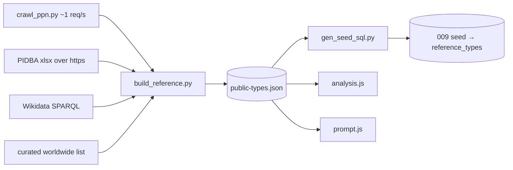

# Published reference layer

`data/reference/public-types.json` (1,621 entries, built 2026-10-15 by `tools/reference/build_reference.py`). It ships as a static file and, once migration 009 is applied, as the `reference_types` table.

## Entry shape
Each entry has these fields:
- `id`, `name`, `aliases`, `typology_system`, `category`
- `period`, `dates`
- `continent`, `country[]`, `admin1[]`, `region_notes`
- `length_mm` / `width_mm` / `thickness_mm` as `[min,max]`
- `pidba` (5th-95th percentile measured ranges, with `n`)
- `traits[]`: keyword tags from a fixed vocabulary; the regexes are in `meta.trait_patterns`
- `similar[]`, `validity`, `texas`, `home_priority`
- `sources[{name,url,retrieved,license}]`

Only short facts and our own tags are stored. **No text passages and no images are copied.** The UI links to the source page.

## Counts
| Source | Entries | License / terms handling |
|---|---|---|
| projectilepoints.net (every type page reachable from the state and province indexes) | 1,513 | robots.txt places no restrictions and no explicit license is stated. We keep facts only and link back. Crawled at about 1 request per second |
| PIDBA (Paleoindian Database of the Americas) measurement spreadsheets | 27 new entries, plus 18 merged into matching ppn entries (36 types with ≥5 measured points) | CC BY 4.0, attributed |
| Wikidata (archaeological cultures and lithic industries) | 72 | CC0 |
| Wikipedia | 72 (link only, alongside the Wikidata entries) | CC BY-SA. Links only, no text |
| Rolling Oak curated worldwide summaries | 27 | Our own wording, with links to the open sources |

| Region | Entries |
|---|---|
| North America | 1,523 (Texas 290; then Kentucky 273, Tennessee 257, Alabama 256, Illinois 236) |
| Europe (incl. mixed Europe/Asia/Africa) | 20 |
| Africa | 10 |
| Asia | 7 |
| South America | 6 |
| Oceania | 2 |
| Unspecified (Wikidata entries with no location) | 53 |

1,117 entries have a size range and 1,523 have trait tags.

## Not used, because of their terms
- Texas Beyond History, Overstreet guides, and commercial point-guide or arrowhead-dealer sites: copyrighted, with no reuse grant.
- Museum image collections: images are never hotlinked or copied.
- Lithics-casting and dealer catalogues.

These are linked from docs at most and never crawled.

## Retrieval
- **Rules engine:** see [rules-engine.md](rules-engine.md). points.json wins where it overlaps.
- **AI:** `Prompt.rankReferences` picks the top 5 (see [ai-prompt.md](ai-prompt.md)). Region is a bonus, never a filter, so a Dordogne find still sees worldwide entries.

Rebuild with `python3 tools/reference/build_reference.py` (it needs the crawl caches), then `python3 tools/reference/gen_seed_sql.py`.
