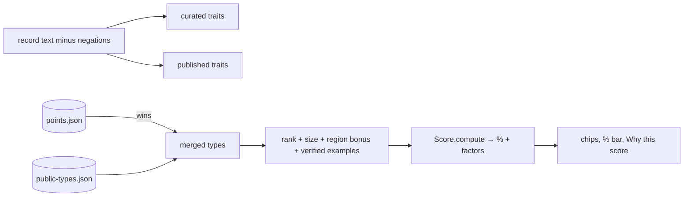

# Rules engine (`assets/js/analysis.js`)

The rules engine works offline and needs no AI. It ranks candidate types for a find from the curated `data/reference/points.json` plus the published layer `data/reference/public-types.json`.

**Merge (`mergeRefs`):**
- A published entry whose name or alias matches a points.json type attaches to that type as `refs`. **points.json wins**: its name, period, traits and size range are kept, and the published data adds source chips and extra traits.
- Generic forms (biface, preform, scraper, flake tool, core, hammerstone) never absorb a named published type.
- Unmatched entries become `ref:` types that carry their published traits.

**Score per type:**
| Signal | Points |
|---|---|
| Listed as your #1 / #2 / #3 possibility | +4 / +2.5 / +1.5 |
| Curated trait matches | +1 each, max 5 |
| Published trait matches | +0.3 each on curated types, +0.6 on published-only types, max 6 |
| Alias mentioned | +2 |
| Reported from the find's admin1 (bonus only) | +0.5 |
| Conflicting `excludes` words | −2 each |
| Length inside the typical range / outside it | +1 / −1.5 |
| Verified example of this type: the same find / similar finds (Jaccard ≥0.12) | +3 / up to +3 |

- Published-only types appear only with a name mention or ≥3 published trait hits. This keeps worldwide entries from crowding out local types.
- Negated phrases ("not ground", "no notches") are removed before matching.
- The top 5 are shown, each with source chips (links), a "Reference details" dialog, the earned % bar and "Why this score".
- If `points.json` or `public-types.json` fails to load, a toast and a `#refErr` alert banner appear, and ranking continues with whatever did load.

