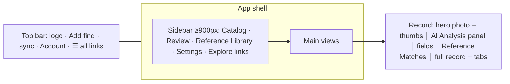

# UI redesign (preview)

Warm earth-tone dashboard: beige background `#f4ede1`, terracotta primary `#b0502a`, charcoal text `#2b2622`, deep green `#2f6b45` for accents and success.
- Text-colour contrast is ≥4.5:1, except that yellow is used only on large or bold text (≥3:1).
- Dark mode is kept and adapted.
- Files: `assets/css/redesign.css` (overrides only, loaded after styles.css) and `assets/js/redesign.js`.
- Service worker version: `ro-v8.4`.

- **Sidebar**
  - Shown at ≥900 px.
  - Below that it is hidden, and the existing ☰ drawer carries every link, now including Review, Reference Library and Settings.
- **Review screen** (record Overview tab). New content is added on top; the full original record and all four tabs remain below it.
  - Large photo with thumbnails. Clicking the photo opens the existing lightbox.
  - AI Analysis panel:
    - earned % ("NN% High Confidence") with a coloured bar
    - Suggested type
    - Why this score
    - Keep, Correct this (both drive the existing correction controls) and Add measurement (Measurements tab)
    - the disclaimer
  - Fields:
    - status badge (S5)
    - "🔒 Location: Private" (or County / Fuzzed only)
    - visibility chip
    - material, length, width, method, notes
  - **Reference Matches:** up to 6 published references (`Prompt.rankReferences`). Each card shows its source (PIDBA, projectilepoints.net, …), its match score, a source-page link and Details. Cards use a **generic silhouette placeholder; source images are never hotlinked**.
- **Review queue** (`#/review`): finds where `S5.needs()` is true, with their top match and %.
- **Reference Library** (`#/library`):
  - browses all 1,621 reference types
  - search plus region (continent / state), source and period filters, 48 per page, Texas first
  - Details opens the reference dialog
  - reads `public-types.json`; when 009 is applied, the same rows are in `reference_types`
- **Settings** (`#/settings`):
  - account and sign-in, profile, members, membership
  - dark mode, install
  - exports, labels, map
  - the scoring configuration and disclaimer
  - links to Discover, Deep time, People & land, About/legal
- Catalog, Discover, Pricing, the Add-find wizard, measurement entry and print share the same tokens. Print hides the shell.

Test: `python3 tests/redesign_regress.py URL [shots]` (desktop 1280 and mobile 390).
