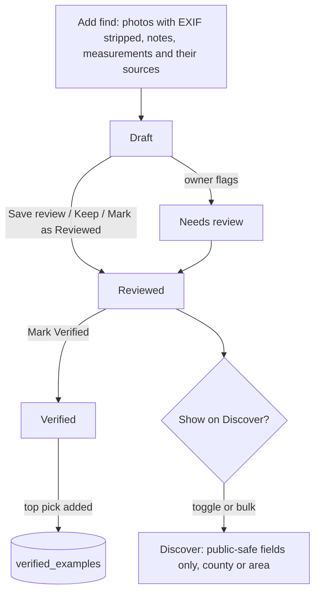

# User flows

1. **Add:** a wizard collects photos, notes and measurements. Each measurement records its source (measured, ruler:N, photo estimate). Location goes to the owner-only `find_locations` table; the record keeps only the county or area.
2. **Analysis tab:** shows the rules-engine possibilities, each with an **earned %**, a red/yellow/green bar, **Why this score**, source chips and **Reference details**. The owner can Keep or correct each field.
3. **AI analysis (Supporters):** opens the AI dialog. It shows ranked candidates with % and factors, suggested marks, the external references used, the reference status, and **View AI prompt**. Nothing is saved until the owner clicks **Accept selected**. If something fails, a visible alert appears and the rules engine keeps working.
4. **Status:** a find moves Draft → Needs review → Reviewed → Verified. A Verified top pick that agrees with published references is the only way to reach 100%.
5. **Discover:** finds are opted in one by one or in bulk. Visitors see only the `discover_finds` view (no location columns).
6. **Learning:** feedback (Matches well / Close / Wrong) and corrections feed future scores (see [confidence-scoring.md](confidence-scoring.md)).
